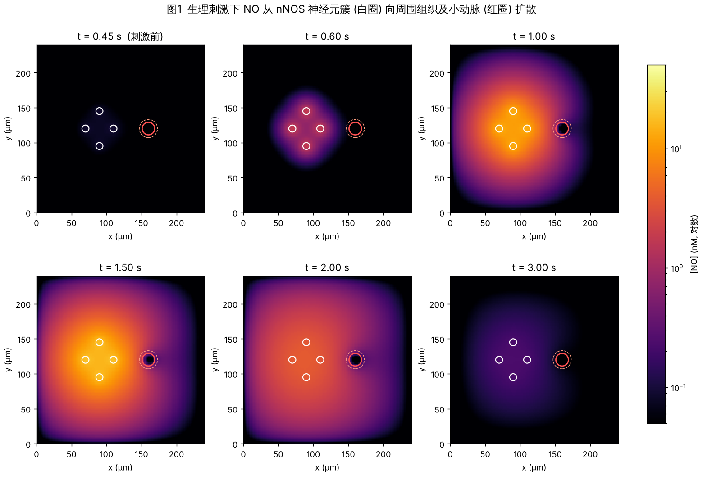
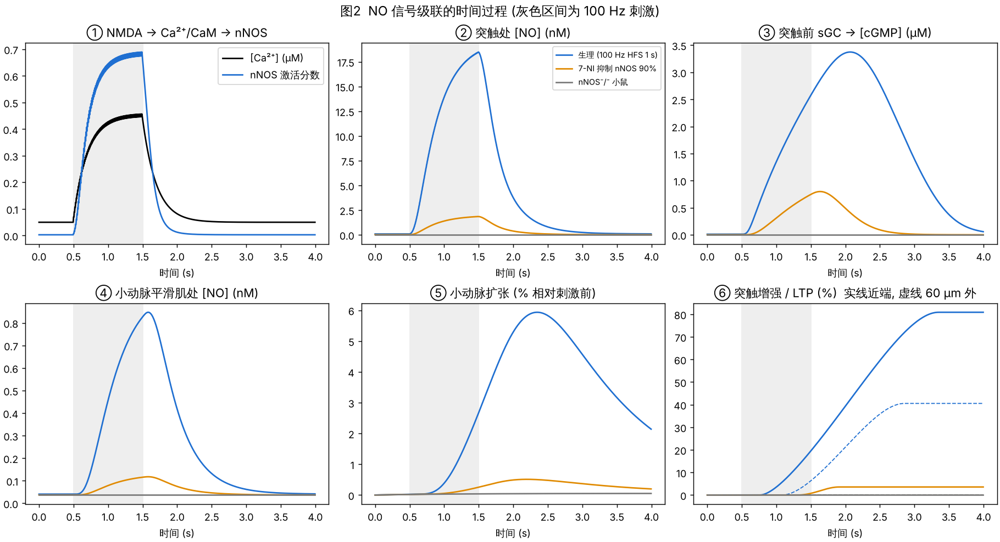
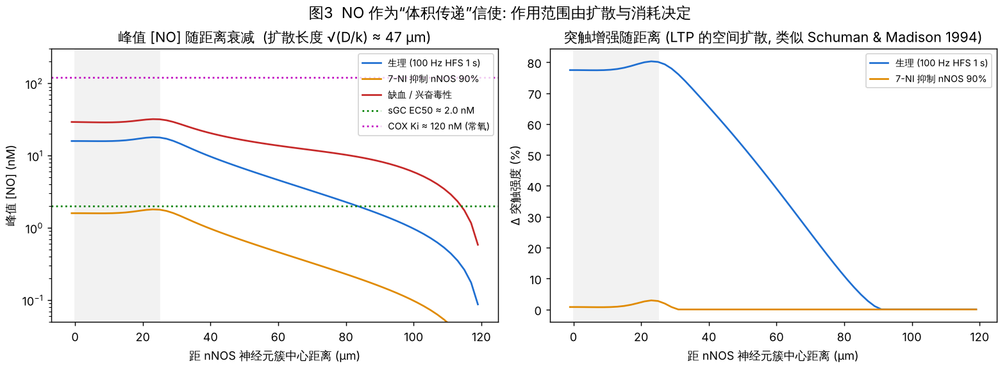
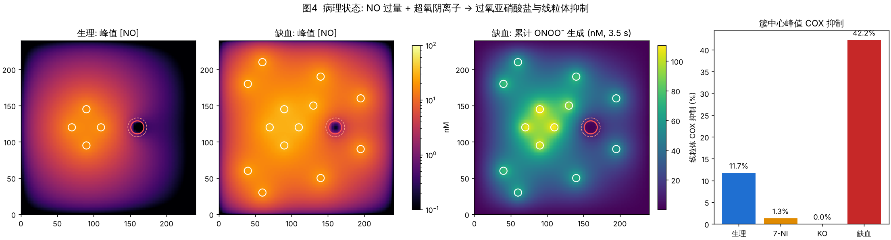

# 一氧化氮 (NO) 在小鼠脑神经通路中的作用：分析与仿真

> 代码：`sim/no_model.py`（模型）、`sim/run_all.py`（场景与作图）
> 结果：`results/`（图 1–4、`NO_diffusion.gif`、`summary.json`）
> 运行：`pip install numpy matplotlib && python3 sim/run_all.py`（约 1.5 分钟）

---

## 1. 背景：NO 是一种“非典型”神经递质

| 特点 | 经典递质（谷氨酸、GABA） | NO |
|---|---|---|
| 储存 | 囊泡 | 不储存，按需合成 |
| 释放 | 胞吐，作用于突触间隙 | 气体自由穿膜扩散，三维“体积传递” |
| 受体 | 膜受体 | 胞内可溶性鸟苷酸环化酶 (sGC) 的血红素 |
| 终止 | 重摄取/酶解 | 被组织消耗、血红蛋白清除，半衰期 ~0.1–1 s |
| 方向 | 突触前 → 突触后 | 可逆行（突触后 → 突触前）、可旁及邻近突触与血管 |

### 1.1 三种 NOS 亚型

| 亚型 | 基因 | 脑内来源 | 调控 | 作用 |
|---|---|---|---|---|
| nNOS | *Nos1* | 神经元（通过 PDZ 结构域与 PSD-95 偶联于 NMDA 受体） | Ca²⁺/CaM 依赖 | 突触可塑性、神经血管耦联、兴奋毒性 |
| eNOS | *Nos3* | 血管内皮 | Ca²⁺/CaM + 剪切力、Akt 磷酸化 | 基础血管张力、脑血流 |
| iNOS | *Nos2* | 小胶质细胞、星形胶质细胞（炎症诱导） | 不依赖 Ca²⁺，持续高产 | 神经炎症、迟发性损伤 |

### 1.2 小鼠脑中 nNOS 的主要分布

- **小脑**：颗粒细胞、篮状/星状细胞 nNOS 极丰富；NO 介导平行纤维–浦肯野细胞 LTD 与 LTP。
- **海马**：CA1 锥体细胞树突、部分中间神经元；NO 作为逆行信使参与 LTP（尤其是需要突触前表达的成分）。
- **大脑皮层**：nNOS⁺ 中间神经元（I 型强表达，多共表达 SST/NPY）；是**神经血管耦联**的重要介质（如触须刺激引起桶状皮层小动脉扩张）。
- **纹状体**：SST/NPY/nNOS 中间神经元，调节皮质纹状体可塑性与多巴胺信号。
- **下丘脑**（室旁核、视上核）、**嗅球**、**脑干**：调节神经内分泌、嗅觉记忆、自主神经。

### 1.3 核心信号通路

**上游（产生）**：谷氨酸 → NMDA 受体 → Ca²⁺ 内流 → Ca²⁺/CaM → nNOS（经 PSD-95 锚定于 NMDA 受体旁）；L-精氨酸 + O₂ → **NO** + L-瓜氨酸

**传播**：NO 自由扩散（D ≈ 3300 μm²/s），被组织消耗、被血管内血红蛋白清除

**下游（三条分支）**

| 分支 | 靶点与级联 | 结果 |
|---|---|---|
| 突触 | 突触前 sGC → cGMP → PKG | 释放概率↑ → LTP（小脑平行纤维–浦肯野细胞可为 LTD） |
| 血管 | 平滑肌 sGC → cGMP → PKG → 肌球蛋白轻链去磷酸化 | 小动脉扩张（神经血管耦联） |
| 病理 | NO + O₂⁻ → ONOO⁻；NO 与 O₂ 竞争线粒体 COX；S-亚硝基化（NMDA 受体、caspase、GAPDH 等） | 蛋白硝基化、DNA 损伤、PARP 过度激活、能量衰竭 |

**终止**：PDE（PDE2/5/9）降解 cGMP

### 1.4 小鼠遗传学证据（要点）

- **nNOS⁻/⁻**：雄鼠攻击性增强、幽门狭窄；海马 LTP 部分受损（与 eNOS 双敲除时更明显）；**脑缺血梗死体积减小**——提示 nNOS 源 NO 在急性缺血期主要有害。
- **eNOS⁻/⁻**：高血压、脑血流调节受损、缺血梗死**增大**——提示内皮 NO 具保护作用。
- **iNOS⁻/⁻**：缺血后迟发损伤减轻、炎症模型中神经元存活改善。
- **药理学**：7-硝基吲唑 (7-NI，相对 nNOS 选择性) 与 L-NAME (非选择性) 可阻断 NMDA 诱发的 cGMP 升高、减弱功能性充血。

---

## 2. 仿真模型

### 2.1 结构

二维脑片（240 × 240 μm，网格 2 μm），包含 4 个被刺激的 nNOS 神经元簇和一根穿通小动脉（直径 18 μm，外包 4 μm 平滑肌层）。

| 模块 | 方程 | 关键参数 |
|---|---|---|
| Ca²⁺ | dCa/dt = −(Ca−Ca₀)/τ + Σ ΔCa·δ(t−tᵢ) | Ca₀ = 50 nM，τ = 0.2 s，100 Hz × 1 s |
| nNOS 激活 | a = Caⁿ/(Kⁿ+Caⁿ) | K = 0.35 μM，n = 3 |
| NO 反应–扩散 | ∂[NO]/∂t = D∇²[NO] − k(x)[NO] − k_f[O₂⁻][NO] + P(x,t) | D = 3300 μm²/s；组织 k = 1.5 s⁻¹；血管腔 k = 800 s⁻¹（Hb） |
| eNOS 张力性来源 | 内皮像素恒定产率 | 20 nM/s |
| sGC → cGMP | dc/dt = V_sGC·Hill(NO) − V_PDE·c/(K+c) | sGC EC50 = 2 nM，n = 1.5 |
| PKG | P = c/(c+0.4 μM) | |
| 突触增强 | dw/dt = η·max(0, P−θ) | θ = 0.6 |
| 血管 | dd/dt = (d_max·P_SMC − d)/τ_v | d_max = 30%，τ_v = 1.2 s |
| 病理 | ONOO⁻ 生成 = k_f[NO][O₂⁻]；COX 抑制 = NO/(NO+K_i) | k_f = 10¹⁰ M⁻¹s⁻¹；K_i 常氧 120 nM / 低氧 40 nM |

数值方法：显式有限差分，dt = 0.25 ms（满足 dt < dx²/4D），先预平衡 2 s 建立 eNOS 张力性 NO 与基础 cGMP。

### 2.2 场景

1. **生理**：4 个 nNOS 神经元接受 100 Hz、1 s 高频刺激（经典 LTP 诱导范式）。
2. **7-NI**：nNOS 产率降至 10%。
3. **nNOS⁻/⁻**：nNOS 产率为 0（仅 eNOS）。
4. **缺血 / 兴奋毒性**：13 个 nNOS 神经元被谷氨酸持续去极化（Ca²⁺ 平台 2 μM）、O₂⁻ 0.1 nM、低氧使组织 NO 消耗减慢 (k = 0.8 s⁻¹)、COX 的 K_i 降至 40 nM。

---

## 3. 结果

| 指标 | 生理 | 7-NI | nNOS⁻/⁻ | 缺血 |
|---|---|---|---|---|
| 突触处峰值 NO (nM) | 18.5 | 1.9 | ≈0 | 32.5 |
| 突触前峰值 cGMP (μM) | 3.4 | 0.8 | ≈0 | 7.3 |
| 突触增强 – 近端 (%) | **+81** | +3.6 | 0 | 不适用 |
| 突触增强 – 60 μm 外 (%) | **+41** | 0 | 0 | 不适用 |
| 平滑肌峰值 NO (nM) | 0.85 | 0.12 | 0.04 (eNOS) | 3.6 |
| 小动脉最大扩张 (%) | **5.9** | 0.5 | 0.1 | 23.5 |
| 簇中心 COX 抑制 (%) | 11.7 | 1.3 | 0 | **42.2** |
| 累计 ONOO⁻ (nM, 3.5 s) | 0 | 0 | 0 | **111** |

### 3.1 图 1 – 空间扩散（`results/fig1_NO_spatial_physio.png`）
刺激开始约 0.1 s 内，NO 即从神经元簇向外形成直径 >100 μm 的“云”；血管腔是明显的“黑洞”——血红蛋白强力清除 NO，使血管周围形成陡峭梯度。刺激停止后约 1 s 内 NO 回落到基线。

### 3.2 图 2 – 级联时间过程（`fig2_pathway_timecourse.png`）
- Ca²⁺ 升至 ~0.45 μM，由于 CaM 的协同性，nNOS 激活达 ~70%，表现为“开关”样。
- NO 随刺激上升、停止后快速衰减；cGMP 峰值滞后约 0.5 s，并持续更久（PDE 降解较慢）——**cGMP 是对 NO 信号的时间积分器**。
- 血管扩张再滞后约 1 s，符合在体功能性充血的时间尺度。
- 7-NI 抑制 90% 的 nNOS 后，NO 仍有 ~2 nM（接近 sGC EC50），cGMP 仍有约 1/4，但已不能跨过 LTP 阈值——解释了为何**部分抑制 NOS 往往也能阻断 LTP**：效应具有阈值性。

### 3.3 图 3 – 体积传递（`fig3_distance_dependence.png`）
扩散长度 √(D/k) ≈ 47 μm。峰值 NO 在约 80 μm 处才降到 sGC EC50 以下，因此**距激活簇 60–80 μm、自身未被刺激的突触也被增强**（+41%@60 μm）。这再现了 Schuman & Madison (1994) 在海马中观察到的 LTP 向邻近突触扩散的现象，也说明 NO 信号的“特异性”来自于**与突触前活动的同时性**（实际系统中 sGC/PKG 效应常需与突触前活动配合），而不是空间限定。

### 3.4 图 4 – 病理（`fig4_pathology.png`）
缺血时多神经元持续激活 + 消耗减慢使 NO 在整片组织维持在 10–30 nM 以上：
- 与 O₂⁻ 以扩散限速反应生成 ONOO⁻，在神经元簇附近累计 >100 nM（仅 3.5 s，实际缺血持续分钟–小时）；
- 低氧时 NO 与 O₂ 竞争 COX 的能力增强，COX 抑制达 ~42%，加剧能量衰竭；
- 这与 nNOS⁻/⁻ 小鼠梗死体积减小、而 eNOS（血管扩张，模型中扩张 23%）具保护作用的遗传学结果相一致——**同一分子，来源与浓度决定“保护”还是“毒性”**。

`results/NO_diffusion.gif` 并排展示生理与缺血条件下 NO 场的演化。

---

## 4. 结论

1. **nNOS 是 Ca²⁺ 的阈值检测器**：CaM 的协同性把 NMDA 介导的 Ca²⁺ 升高转换为近乎全或无的 NO 产生。
2. **NO 是体积信使**：数十微米的作用范围使其能同时协调突触（逆行 LTP）与血管（神经血管耦联），但牺牲了单突触特异性。
3. **生理 NO 浓度为个位数至十几 nM**，恰处在 sGC 的敏感区间（EC50 ~ 1–10 nM），远低于抑制线粒体所需浓度。
4. **病理性 NO** 由“更多来源 × 更长时间 × 更慢清除 × 超氧共存”造成，危害主要来自 ONOO⁻ 与线粒体抑制，而非 NO 本身的信号作用。
5. 干预启示：选择性阻断 nNOS–PSD-95 偶联（如 Tat-NR2B9c / nerinetide、ZL006）可在不影响 eNOS 的前提下减少兴奋毒性 NO，这是近年卒中神经保护研究的方向。

## 5. 模型局限

- 二维几何，边界设为零浓度（图 3 中 ~110 μm 以外的骤降为边界效应）；真实组织为三维，峰值浓度会略低。
- 组织 NO 消耗用一级动力学近似；实际存在浓度依赖的消耗（Hall & Garthwaite 2006）。
- 未包含 sGC 脱敏、PDE 亚型差异、S-亚硝基化、iNOS 迟发表达及其他神经血管耦联介质（PGE₂、EETs、K⁺）。
- 参数为文献数量级的代表值，可用于定性比较与假说探索，不能直接替代实验测量。

## 参考文献（选）

- Garthwaite J. (2008) Concepts of neural nitric oxide-mediated transmission. *Eur J Neurosci* 27:2783.
- Hall CN, Garthwaite J. (2009) What is the real physiological NO concentration *in vivo*? *Nitric Oxide* 21:92.
- Schuman EM, Madison DV. (1994) Locally distributed synaptic potentiation in the hippocampus. *Science* 263:532.
- Huang PL et al. (1994) Effects of cerebral ischemia in mice deficient in neuronal nitric oxide synthase. *Science* 265:1883.
- Huang Z et al. (1996) Enlarged infarcts in endothelial nitric oxide synthase knockout mice. *J Cereb Blood Flow Metab* 16:981.
- Nelson RJ et al. (1995) Behavioural abnormalities in male mice lacking neuronal nitric oxide synthase. *Nature* 378:383.
- Zhou L, Zhu DY. (2009) Neuronal nitric oxide synthase: structure, subcellular localization, regulation, and clinical implications. *Nitric Oxide* 20:223.
- Lourenço CF et al. (2014) Neurovascular coupling in hippocampus is mediated via diffusion by neuronal-derived nitric oxide. *Free Radic Biol Med* 73:421.
- Aarts M et al. (2002) Treatment of ischemic brain damage by perturbing NMDA receptor–PSD-95 protein interactions. *Science* 298:846.
