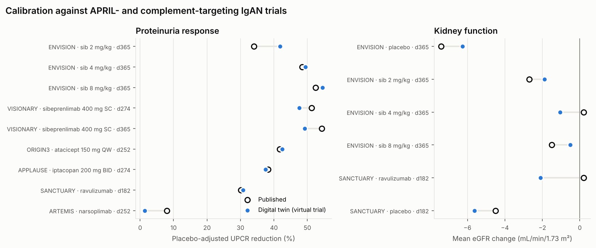
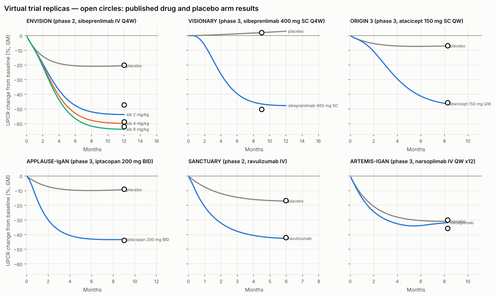
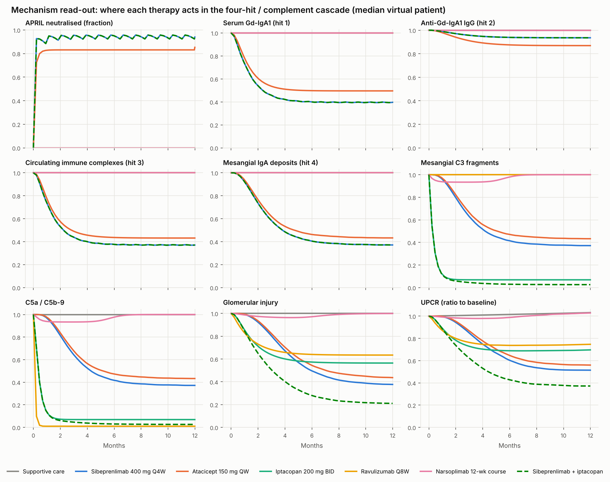
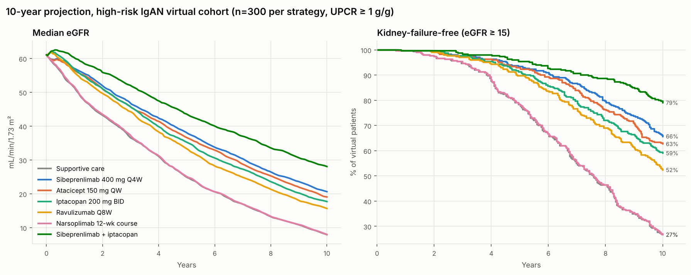
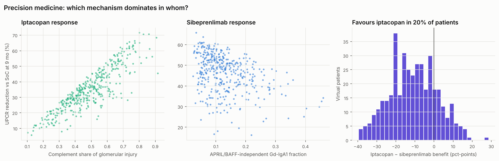
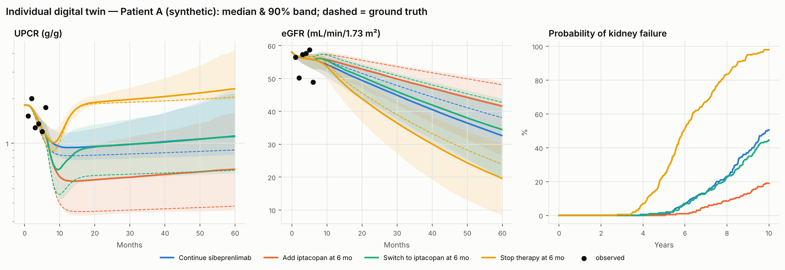

# IgAN digital twin — run report

Generated by `python -m igan_twin all`. All results are model outputs from virtual patients; they are research hypotheses, not clinical recommendations.

## 1. Calibration against published trials

Each trial was re-simulated with a fresh virtual cohort (n per arm shown in CLI output). UPCR targets are placebo-adjusted geometric-mean reductions.

| Trial | Endpoint | Arm | Day | Published | Twin |
|---|---|---|---|---|---|
| ENVISION | UPCR reduction vs placebo | sib 2 mg/kg | 365 | 34% | 42% |
| ENVISION | UPCR reduction vs placebo | sib 4 mg/kg | 365 | 48% | 49% |
| ENVISION | UPCR reduction vs placebo | sib 8 mg/kg | 365 | 52% | 55% |
| ENVISION | eGFR change (mL/min) | placebo | 365 | -7.4 | -6.3 |
| ENVISION | eGFR change (mL/min) | sib 2 mg/kg | 365 | -2.7 | -1.9 |
| ENVISION | eGFR change (mL/min) | sib 4 mg/kg | 365 | +0.2 | -1.1 |
| ENVISION | eGFR change (mL/min) | sib 8 mg/kg | 365 | -1.5 | -0.5 |
| ENVISION | Gd-IgA1 vs baseline | sib 8 mg/kg | 365 | -65% | -66% |
| VISIONARY | UPCR reduction vs placebo | sibeprenlimab 400 mg SC | 274 | 51% | 48% |
| VISIONARY | UPCR reduction vs placebo | sibeprenlimab 400 mg SC | 365 | 54% | 49% |
| ORIGIN3 | UPCR reduction vs placebo | atacicept 150 mg QW | 252 | 42% | 42% |
| ORIGIN3 | Gd-IgA1 vs baseline | atacicept 150 mg QW | 252 | -60% | -50% |
| APPLAUSE | UPCR reduction vs placebo | iptacopan 200 mg BID | 274 | 38% | 37% |
| SANCTUARY | UPCR reduction vs placebo | ravulizumab | 182 | 30% | 31% |
| SANCTUARY | eGFR change (mL/min) | ravulizumab | 182 | +0.2 | -2.1 |
| SANCTUARY | eGFR change (mL/min) | placebo | 182 | -4.5 | -5.6 |
| ARTEMIS | UPCR reduction vs placebo | narsoplimab | 252 | 8% | 1% |

## 2. Calibrated population parameters

| Parameter | Value | Approx. 95% range | Unit | Meaning |
|---|---|---|---|---|
| `ec50_sib` | 2.61 | 0.954 – 7.15 | mg/L | sibeprenlimab in-vivo EC50 for APRIL neutralisation |
| `ec50_ata` | 1.58 | 0.778 – 3.22 | mg/L | atacicept in-vivo EC50 for APRIL/BAFF neutralisation |
| `f_ind_gd` | 0.11 | 0.0204 – 0.425 | – | APRIL/BAFF-independent fraction of Gd-IgA1 production (long-lived PCs) |
| `f_ind_g` | 0.77 | 0.18 – 0.981 | – | APRIL/BAFF-independent fraction of IgG autoantibody production |
| `t_half_deposit` | 22.2 | 2.48 – 198 | days | mesangial immune-deposit clearance half-life |
| `phi` | 0.83 | 0.6 – 0.941 | – | reversible (immune-active) share of proteinuria |
| `w_direct` | 0.489 | 0.3 – 0.681 | – | complement-independent share of deposit-driven injury |
| `c3_share` | 0.222 | 0.0476 – 0.62 | – | C3a/C3b share of complement injury (rest: C5a/C5b-9) |
| `loop_gain` | 0.781 | 0.174 – 0.984 | – | alternative-pathway amplification loop gain |
| `f_lectin` | 0.175 | 0.0117 – 0.791 | – | lectin-pathway share of complement initiation |
| `k_upcr` | 0.0664 | 0.0394 – 0.112 | 1/yr per g/g | proteinuria-driven nephron loss rate |
| `psi` | 0.102 | 0.0431 – 0.221 | – | reversible fraction of eGFR suppressed by active injury |

Ranges are Gauss-Newton approximations including the weak prior; wide ranges flag parameters the trial summaries cannot pin down.

## 3. Mechanism and 10-year strategy projection

| Strategy | UPCR reduction vs SoC (9 mo) | Gd-IgA1 | Deposits | C3 | C5b-9 | eGFR slope yr 1–2 | KF-free at 10 y |
|---|---|---|---|---|---|---|---|
| Supportive care | 0% | 100% | 100% | 100% | 100% | -8.1 | 27% |
| Sibeprenlimab 400 mg Q4W | 48% | 40% | 38% | 38% | 38% | -5.2 | 66% |
| Atacicept 150 mg QW | 43% | 50% | 43% | 44% | 44% | -5.5 | 63% |
| Iptacopan 200 mg BID | 39% | 100% | 100% | 8% | 8% | -6.0 | 59% |
| Ravulizumab Q8W | 33% | 100% | 100% | 100% | 1% | -6.4 | 52% |
| Narsoplimab 12-wk course | 1% | 100% | 100% | 100% | 100% | -8.1 | 27% |
| Sibeprenlimab + iptacopan | 64% | 40% | 38% | 3% | 3% | -4.2 | 79% |

Biomarker columns are geometric-mean levels relative to baseline at 9 months.

## 4. Individual twin demonstration

Synthetic patient: eGFR 58, UPCR 1.8 g/g, FHR-5/FH ×1.6, mesangial C3 3+, MEST-C M1E1S1T0C0. Six monthly visits on sibeprenlimab were simulated from hidden 'true' random effects with realistic measurement noise; the twin was fitted to those visits only.

| Random effect | True | Estimated (± SD) |
|---|---|---|
| f_ind_gd | +0.80 | +0.75 ± 0.53 |
| w_comp | +0.90 | +0.04 ± 1.00 |
| phi | +0.30 | -0.61 ± 0.91 |
| kD | +0.20 | -0.46 ± 0.92 |
| prog | +0.40 | +0.62 ± 0.84 |

Six months on an anti-APRIL drug identify the APRIL-dependence and progression effects. They say almost nothing about the complement share (posterior SD stays near the prior's 1.0), because APRIL blockade lowers every complement-driven term in proportion. The forecasts for adding or switching to iptacopan are correspondingly wide. In practice a complement biomarker (urinary C5b-9, plasma Bb, mesangial C3 on repeat biopsy) or a short iptacopan exposure would narrow them. The twin reports this uncertainty instead of hiding it.

| Scenario after month 6 | eGFR at 5 y (twin median) | eGFR at 5 y (truth) | P(kidney failure by 10 y) |
|---|---|---|---|
| Continue sibeprenlimab | 33 | 38 | 50% |
| Add iptacopan at 6 mo | 42 | 48 | 19% |
| Switch to iptacopan at 6 mo | 35 | 43 | 44% |
| Stop therapy at 6 mo | 20 | 24 | 98% |

## 5. Sources of calibration data

- **ENVISION** — Mathur M et al. A Phase 2 Trial of Sibeprenlimab in Patients with IgA Nephropathy. NEJM 2024;390:20-31. PMID 37916620
- **VISIONARY** — Otsuka press release / ERA 2025 late-breaker, 6 Jun 2025 (prespecified interim, n=320)
- **VISIONARY** — UKKW 2026 report (12-month data), EMJ Nephrology
- **ORIGIN3** — Lafayette R et al. A Phase 3 Trial of Atacicept in Patients with IgA Nephropathy. NEJM 2025 (interim, n=203)
- **APPLAUSE** — Perkovic V et al. APPLAUSE-IgAN interim analysis, NEJM 2025; Novartis release 15 Apr 2024
- **SANCTUARY** — Lafayette R et al. Efficacy and Safety of Ravulizumab in IgA Nephropathy. JASN 2025. PMID 39455063
- **ARTEMIS** — Omeros press release 16 Oct 2023; EU CTR 2018-000075-33 results

## 6. Limitations

- Calibrated to arm-level summary statistics, not individual patient data; inter-individual variability and covariate effects are priors, not estimates.
- ARTEMIS-IGAN placebo response was not published numerically; the null result is used as a weak target.
- PK models are effective one-compartment approximations; target-mediated disposition is not modelled.
- Long-term eGFR projections rely on the proteinuria–progression link (UPCR as a surrogate); eGFR-slope results from VISIONARY, ORIGIN 3 and APPLAUSE-IgAN should be used to validate them when available.
- The proteinuria-to-nephron-loss rate is calibrated mainly to the steep placebo eGFR losses in ENVISION and SANCTUARY (about -7 to -9 mL/min/yr). Absolute 10-year kidney-failure rates are therefore pessimistic for lower-risk patients; relative comparisons between strategies are more robust.
- Supportive care (RASi/SGLT2i/endothelin antagonism) is represented as the trial background, not mechanistically.
