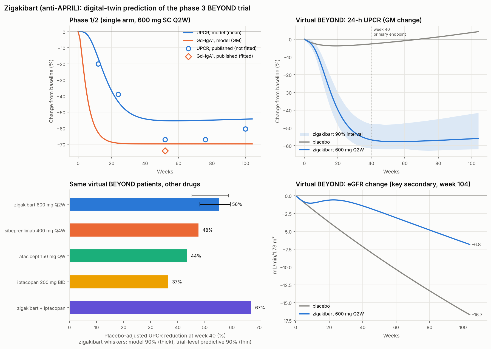

# Zigakibart（诺华，抗 APRIL 单抗）—— 数字孪生预测 BEYOND III 期结果

> **这是模型预测，不是试验结果。** 截至本报告生成时，BEYOND（NCT05852938）尚未公布疗效数据。预测仅基于公开的 I/II 期数据和已校准的 IgAN 机制模型，不能用于临床决策。

## 1. 方法
1. **药效强度只用生物标志物拟合。** I/II 期研究（ADU-CL-19，600 mg 皮下 Q2W）报告约第 52 周时血清 IgA 下降约 67%、Gd-IgA1 下降约 74%。模型只用这一信息拟合 zigakibart 的体内 EC50（1.8 mg/L）。
2. **蛋白尿作为外部验证（未参与拟合）。** 机制链：APRIL 中和 → IgA1 浆细胞 → Gd-IgA1 → 免疫复合物 → 系膜沉积 → 补体（凝集素/旁路途径，C3 → C5b-9）→ 肾小球损伤 → 蛋白尿 → eGFR。
3. **虚拟 BEYOND 试验。** 安慰剂 vs 600 mg Q2W，104 周，主要终点为第 40 周 24 小时 UPCR 变化，关键次要终点为第 104 周 eGFR 变化。不确定性来源：校准参数后验（重要性加权）、生物标志物目标范围、安慰剂组反应（−10% 至 +5%），以及约 383 例受试者的有限样本和测量误差。

## 2. I/II 期验证（单臂）

| 周 | 发表的平均 UPCR 变化 | 模型预测（平均） |
|---|---|---|
| 12 | -20% | -16% |
| 24 | -39% | -44% |
| 52 | -67% | -55% |
| 76 | -67% | -55% |
| 100 | -60% | -54% |

模型 Gd-IgA1 在第 52 周变化 -70%（拟合目标约 −65% 至 −74%）。第 52 周之后模型低估约 6–12 个百分点。单臂开放研究不扣除安慰剂/回归均值效应，而 ENVISION 的安慰剂组下降了 20%，所以这个差距在预期范围内。

## 3. BEYOND 预测

| 指标 | 预测 |
|---|---|
| 第 40 周 UPCR 相对安慰剂降低（模型） | **55%（90% 区间 48%–59%）** |
| 同上，含试验抽样误差的预测区间 | 54%（90% 区间 45%–59%） |
| Zigakibart 组第 40 周 UPCR 相对基线变化 | -56%（90% 区间 -62%–-48%） |
| 第 104 周 eGFR 差值（zigakibart − 安慰剂，mL/min） | +9.1（90% 区间 +6.6–+13.0） |
| 第 104 周 eGFR 变化：zigakibart / 安慰剂 | -7.6 / -16.3 |
| P(观察到的降幅 > 30%) | 100% |
| P(观察到的降幅 > 51.2%，即超过 VISIONARY 中期结果) | 82% |

### 同一虚拟 BEYOND 人群中的其他药物（点估计，非头对头试验数据）

| 方案 | 第 40 周 UPCR 相对安慰剂降低 | 第 40 周 Gd-IgA1 变化 | 第 104 周 eGFR 变化 |
|---|---|---|---|
| placebo | 0% | 0% | -16.7 |
| zigakibart 600 mg Q2W | 56% | -70% | -6.8 |
| sibeprenlimab 400 mg Q4W | 48% | -60% | -8.3 |
| atacicept 150 mg QW | 44% | -51% | -9.1 |
| iptacopan 200 mg BID | 37% | 0% | -10.2 |
| zigakibart + iptacopan | 67% | -70% | -4.2 |

## 4. 解读与局限
- 模型预测 zigakibart 与 sibeprenlimab 同属抗 APRIL 机制。按 I/II 期数据，它的 Gd-IgA1 抑制略深（约 −70% vs −60%），所以预测降幅略高。但这只是间接比较，置信区间重叠。
- **eGFR 的绝对值可能偏悲观。** 模型的肾功能下降速率主要按 ENVISION 和 SANCTUARY 安慰剂组的陡峭下降校准（约 −8 mL/min/年），而近期 III 期试验安慰剂组通常约 −5 至 −7 mL/min/年。104 周 eGFR 差值很可能被高估，相对排序比绝对数值可靠。
- 药代动力学按典型 IgG 假设（t½ 约 15 天）。由于 EC50 按生物标志物拟合，暴露量的误差大部分被吸收。
- BEYOND 的基线特征（UPCR ≥1 g/g、eGFR 约 60）为近似值，以正式发表的基线表为准。
- 后验重要性抽样的有效样本量为 14/160，区间可能略窄。

## 数据来源
- Zigakibart I/II 期：Kidney International 2025（DOI 10.1016/j.kint.2025.05.006）；ERA 2025 长期数据
- BEYOND 设计：ClinicalTrials.gov NCT05852938；Kidney Int Rep 2024（WCN24-1837）
- 校准试验：ENVISION、VISIONARY、ORIGIN 3、APPLAUSE-IgAN、SANCTUARY、ARTEMIS-IGAN（见 REPORT.md）